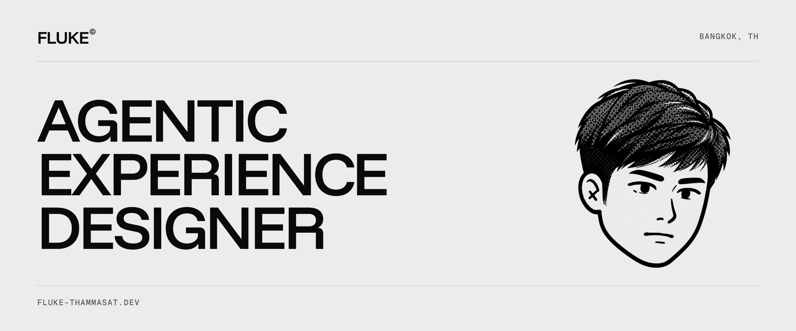
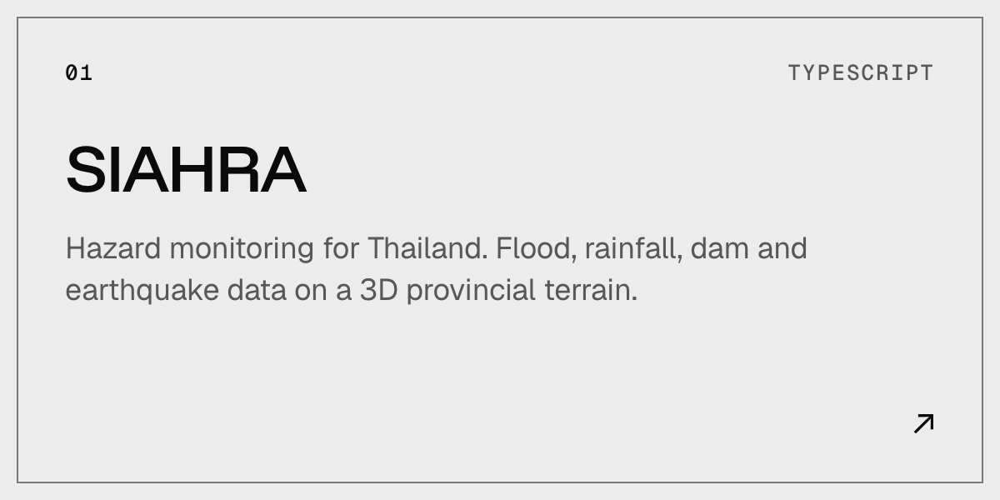
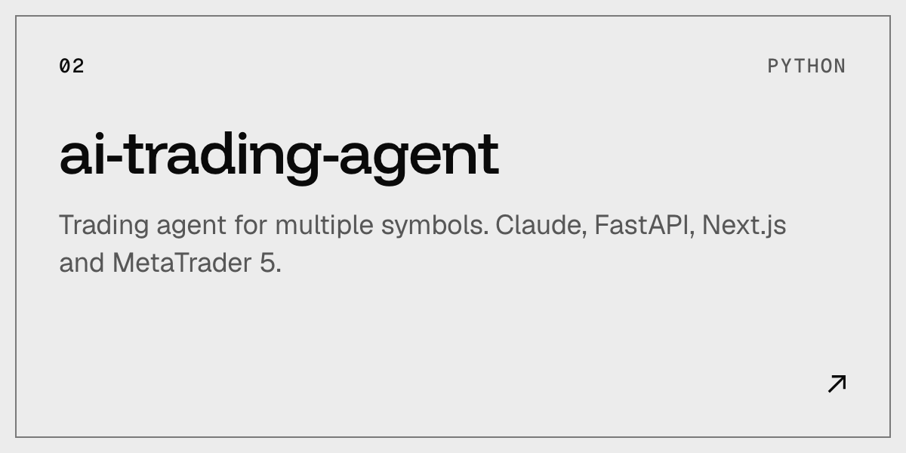
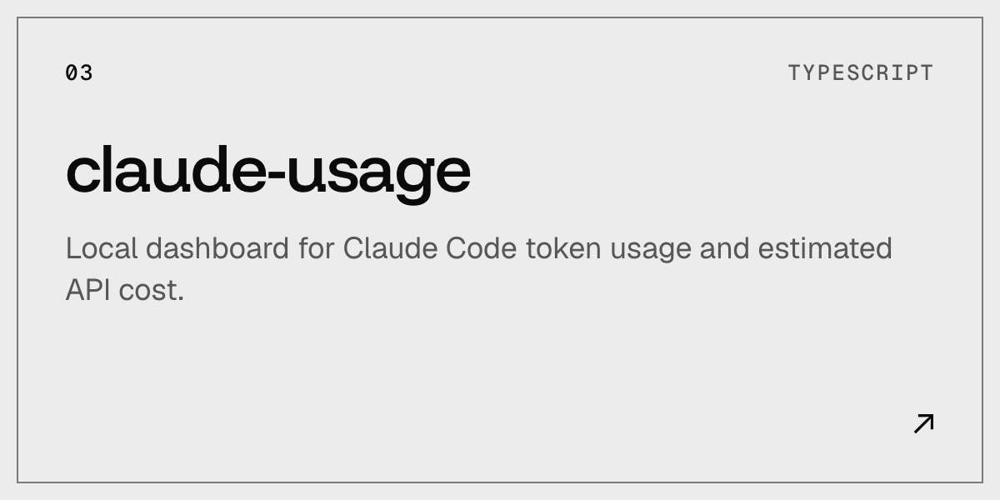
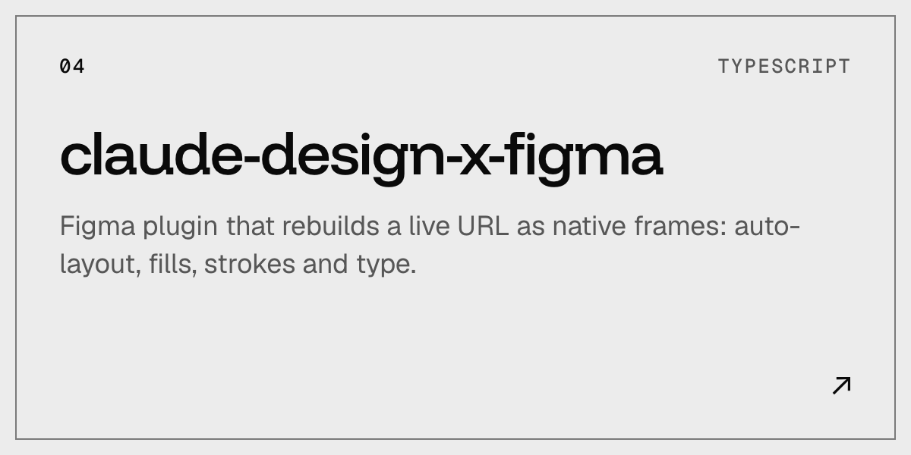
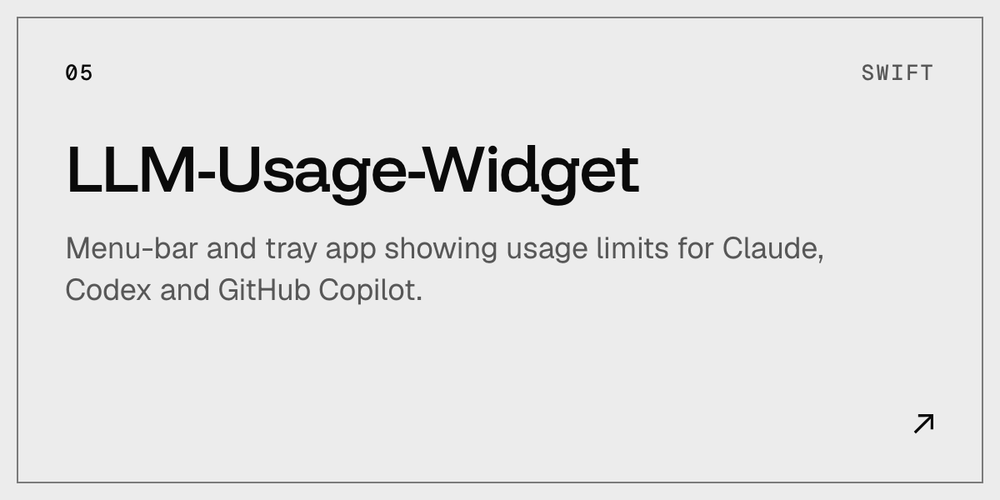
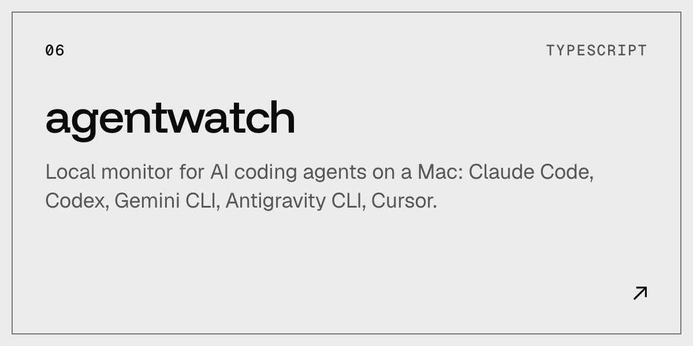

Agentic Experience Designer in Bangkok.

## About

I design LLM-powered products and the multi-agent systems behind them, including the prompts and context they run on. Ten years of UX/UI in fintech, insurance and banking came first: e-KYC, onboarding, loyalty programs and core banking. I build what I design, from the BA/SA spec to a Next.js front end on PostgreSQL, shipped through CI/CD.

## Selected work

Public repositories. SIAHRA is live at [siahra-radar.co](https://siahra-radar.co). Case studies with screens and context are on the [portfolio](https://fluke-thammasat.dev).

## Experience

| | Company | Role |
|:--|:--|:--|
| `2025 –` | Orbit Digital | Lead Experience Designer (from Mar 2026), Senior Experience Designer |
| `2022 – 25` | Bluebik Group | Senior UX/UI Designer. Design system, onboarding, e-KYC, loyalty |
| `2021 – 22` | Krungthai-AXA Life | UX/UI Designer. Insurance policy app, TeleHealth feature |
| `2019 – 20` | PeerPower | UX/UI Designer. Bond investment web and mobile apps |

Earlier: Wewasanad, Maxile and WI Commerce International.

## Contact

[Portfolio](https://fluke-thammasat.dev) · [LinkedIn](https://www.linkedin.com/in/thammasat-pra/) · [Email](mailto:thammasat.pra@gmail.com) · [Medium](https://medium.com/@flukelaster) (mostly Thai)
