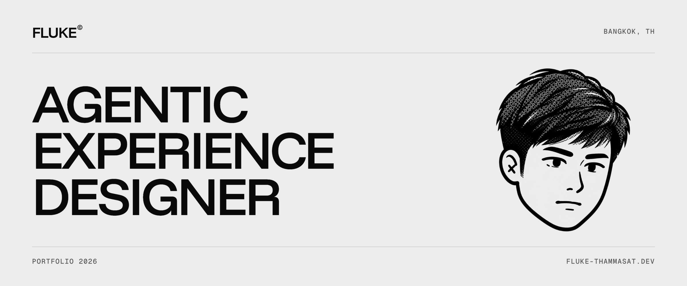

<picture>
  <source media="(prefers-color-scheme: dark)" srcset="assets/header-dark.png">
  
</picture>

Agentic Experience Designer in Bangkok. I work in Thai and English.

## About

I design LLM-powered products and the multi-agent systems behind them, including the prompts and context they run on. Ten years of UX/UI in fintech, insurance and banking came first: e-KYC, onboarding, loyalty programs and core banking. I build what I design, from the BA/SA spec to a Next.js front end on PostgreSQL, shipped through CI/CD.

## Selected work

Public repositories. Case studies with screens and context are on the [portfolio](https://fluke-thammasat.dev).

| | Project | What it does |
|:--|:--|:--|
| `01` | [**SIAHRA**](https://github.com/flukelaster/SIAHRA) | Hazard monitoring for Thailand. Flood, rainfall, dam and earthquake data on a 3D provincial terrain. [siahra-radar.co](https://siahra-radar.co) |
| `02` | [**ai-trading-agent**](https://github.com/flukelaster/ai-trading-agent) | Trading agent for multiple symbols. Claude, FastAPI, Next.js and MetaTrader 5. |
| `03` | [**claude-usage**](https://github.com/flukelaster/claude-usage) | Local dashboard for Claude Code token usage and estimated API cost. |
| `04` | [**claude-design-x-figma**](https://github.com/flukelaster/claude-design-x-figma) | Figma plugin that rebuilds a live URL as native frames, with auto-layout, fills, strokes and type. |
| `05` | [**LLM-Usage-Widget**](https://github.com/flukelaster/LLM-Usage-Widget) | Menu-bar and tray app that shows usage limits for Claude, Codex and GitHub Copilot. macOS and Windows. |
| `06` | [**agentwatch**](https://github.com/flukelaster/agentwatch) | Local monitor for AI coding agents on a Mac: Claude Code, Codex, Gemini CLI, Antigravity CLI and Cursor. |

## Experience

| | Company | Role |
|:--|:--|:--|
| `2025 –` | Orbit Digital | Lead Experience Designer (from Mar 2026), Senior Experience Designer |
| `2022 – 25` | Bluebik Group | Senior UX/UI Designer. Design system, onboarding, e-KYC, loyalty |
| `2021 – 22` | Krungthai-AXA Life | UX/UI Designer. Insurance policy app, TeleHealth feature |
| `2019 – 20` | PeerPower | UX/UI Designer. Bond investment web and mobile apps |

Earlier: Wewasanad, Maxile and WI Commerce International.

## Contact

[Portfolio](https://fluke-thammasat.dev) · [LinkedIn](https://www.linkedin.com/in/thammasat-pra/) · [Email](mailto:thammasat.pra@gmail.com) · [Medium](https://medium.com/@flukelaster) (mostly Thai)
